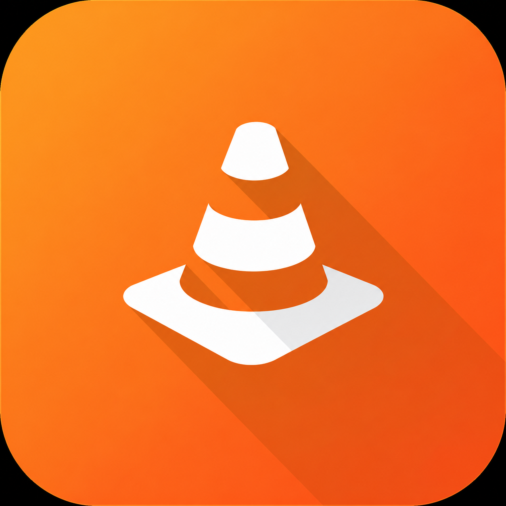

<div align="center">



# VLC for Android — Custom Fork

**The official VLC for Android, plus an AMOLED theme, selectable interface colours,
seek-safe external audio and a screen-anchored subtitle overlay.**

[](https://github.com/subashbuilds/vlc-android/actions/workflows/release-apk.yml)
[](https://github.com/subashbuilds/vlc-android/releases)
[](COPYING)
[](#requirements)
[](https://kotlinlang.org/)
[](https://code.videolan.org/videolan/vlc-android)
[](https://github.com/subashbuilds/vlc-android/commits/master)
[](https://github.com/subashbuilds/vlc-android/stargazers)

[Features](#features) · [Download](#download) · [Build](#building) · [Contributing](#contributing) · [License](#license)

</div>

---

This is a personal fork of [VLC for Android](https://code.videolan.org/videolan/vlc-android). It keeps everything
VLC already does — every format and codec, network streaming, the media library, casting, Android TV — and adds a
handful of features that the upstream app does not have.

> **Not affiliated with VideoLAN.** This is an independent, unofficial build. For the official app, use the
> [Google Play Store](https://play.google.com/store/apps/details?id=org.videolan.vlc) or
> [videolan.org](https://www.videolan.org/vlc/download-android.html).

## Features

| Feature | What it does | Where to find it |
| --- | --- | --- |
| [AMOLED theme](#amoled-theme) | Pure black backgrounds in the dark theme | Settings → Interface |
| [Interface colour](#interface-colour) | Choose the accent colour of the whole app (9 colours) | Settings → Interface |
| [External audio](#external-audio) | Play a separate audio file with a video, with working seek | Player → Audio tracks → *Select audio file* |
| [Subtitle overlay](#subtitle-overlay) | Subtitles drawn on the full screen, independent of video zoom and crop | Settings → Subtitles, or Player → *Subtitle settings* |

### AMOLED theme

Replaces the dark theme's grey surfaces with true black (`#000000`): screen and card backgrounds, bottom sheets,
and the status and navigation bars. Black pixels are switched off on OLED screens, which saves power. It only
applies when the dark theme is active (set manually or following the system).

### Interface colour

Pick the accent colour used across the app and the video player:

Orange (default) · Blue · Teal · Green · Indigo · Purple · Pink · Red · Cyan

Each colour has a light-theme shade and a brighter dark-theme shade for readability. Restart the app after
changing it so that every screen picks it up.

> The AMOLED and interface colour options are part of the phone and tablet interface and are not shown on Android TV.

### External audio

Watch a video with an audio file that is not inside it — a dub, a commentary, a different mix.

- Choose **Select audio file** from the player's audio menu.
- Playback stays in sync: play, pause, **seek**, playback speed, volume and audio delay all apply to the external track.
- The selection is remembered for that video and shows up as a track in the audio menu, so you can switch back to an embedded track at any time.

Upstream libvlc attaches external audio as a "slave" input, and seeking with a slave makes the video jump to
`00:00` and stall while the audio keeps playing. This fork avoids that by playing the file in a companion
player that mirrors the main one.

> External audio is not available while casting to a renderer.

### Subtitle overlay

VLC's own subtitle renderer draws text inside the video image, so subtitles shrink, grow and move whenever you
zoom, crop or change the aspect ratio, and they cannot leave the picture. The overlay draws them in a separate
layer over the **whole screen** instead.

- Subtitles keep a fixed size and position regardless of video zoom, crop or aspect ratio, and can sit in the black bars.
- Works with **external `.srt` files** and with **SubRip and WebVTT tracks embedded** in MKV, WebM and MP4 files (including 3GPP timed text in MP4).
- Follows your existing subtitle style settings (size, colour, bold, background, outline, shadow) and the subtitle delay.
- A **Subtitle position** slider moves the text up or down.
- Opt-in: turn on *Enable subtitle overlay* under Settings → Subtitles. With it off, VLC behaves as usual.

> Styled (ASS/SSA) and bitmap (DVB, VobSub, PGS) subtitles keep their authored layout, so they stay on VLC's
> own renderer.

## Download

Prebuilt APKs are published on the [Releases](https://github.com/subashbuilds/vlc-android/releases) page when a
build is released. You can also build your own — see [Building](#building).

Releases can be split by CPU architecture (ABI). If you are unsure which one you need, `arm64-v8a` fits almost
every phone made in the last several years.

## Requirements

| | |
| --- | --- |
| Android | 4.2+ (API 17) for the default build · API 23+ for the VLC 4 build |
| Target SDK | 36 |
| Architectures | `arm64-v8a`, `armeabi-v7a`, `x86_64`, `x86` |

## Building

The fork follows upstream's build, so a normal build needs no native compilation: Gradle downloads the prebuilt
LibVLC and medialibrary artefacts.

| Component | Version |
| --- | --- |
| JDK | 17 |
| Gradle | 9.3.1 |
| Android Gradle Plugin | 9.1.1 |
| Kotlin | 2.2.10 |
| LibVLC (default, VLC 3) | 3.7.7 |
| LibVLC (VLC 4, `-PforceVlc4=true`) | 4.0.0-eap29 |
| Android SDK platform | 36 |

### Locally

```bash
git clone https://github.com/subashbuilds/vlc-android.git
cd vlc-android

# Debug APKs (one per ABI plus a universal one)
gradle :application:app:assembleDebug

# Optional: build against VLC 4 instead of VLC 3
gradle :application:app:assembleDebug -PforceVlc4=true
```

The repository does not include the Gradle wrapper, so use a local Gradle 9.3.1 (or generate the wrapper with
`gradle wrapper --gradle-version 9.3.1`). APKs are written to `application/app/build/outputs/apk/debug/`.
See [BUILD.md](BUILD.md) for the Android SDK setup, build variants, signing and building LibVLC from source.

### With GitHub Actions

No local setup needed. Both workflows are run manually from the **Actions** tab with **Run workflow**.

| Workflow | Use it to | Options |
| --- | --- | --- |
| [Build APK](.github/workflows/build-apk.yml) | Get a debug APK quickly | Gradle task (default `:application:app:assembleDebug`) |
| [Release APK](.github/workflows/release-apk.yml) | Build signed release APKs | ABI (`all` by default, or one of the four), and an option to publish to the Releases page |

Finished APKs are attached to the run as downloadable artefacts.

Release builds are signed with a key from your repository secrets. Add these once under
**Settings → Secrets and variables → Actions** to get a stable signature that can update over a previous install:

| Secret | Value |
| --- | --- |
| `KEYSTORE_BASE64` | Your keystore, base64-encoded (`base64 -w0 release.jks`) |
| `KEYSTORE_PASSWORD` | Keystore password |
| `KEY_ALIAS` | Key alias |
| `KEY_PASSWORD` | Key password (optional, defaults to the keystore password) |

Without them the workflow signs with a temporary key. The APK installs, but each build has a different signature,
so you must uninstall the previous build before installing the next.

## Project structure

| Folder | Contents |
| --- | --- |
| `application/` | The Android app, split into modules (`app`, `vlc-android`, `television`, `resources`, `tools`, …) |
| `application/vlc-android/src/org/videolan/vlc/subtitleoverlay/` | Subtitle overlay: view, controller, SRT parser and the MKV/MP4 subtitle readers |
| `medialibrary/` | Medialibrary Gradle module |
| `buildsystem/` | Build scripts (including `compile.sh`, used to build LibVLC and the medialibrary from source) |
| `.github/workflows/` | APK build and release workflows for this fork |

## Contributing

Issues and pull requests are welcome for the features listed above. Please open an issue first for anything larger
than a small fix so we can agree on the approach.

For bugs in VLC itself, or features unrelated to this fork, report them upstream on the
[VideoLAN GitLab](https://code.videolan.org/videolan/vlc-android/-/issues), and help with translations on
[Transifex](https://app.transifex.com/yaron/vlc-trans/dashboard/).

## Credits

This project is built on the work of the [VideoLAN](https://www.videolan.org/) team and the many contributors to
VLC and LibVLC. All credit for the player, the engine and the media library goes to them; this fork only adds the
features described above.

## License

The application is licensed under [GPLv2 or later](COPYING). Combined with the Android libraries it uses, this
makes it effectively a GPLv3 application. LibVLC, the VLC engine, is licensed under the LGPLv2.

"VLC" and the VLC cone are trademarks of VideoLAN.
